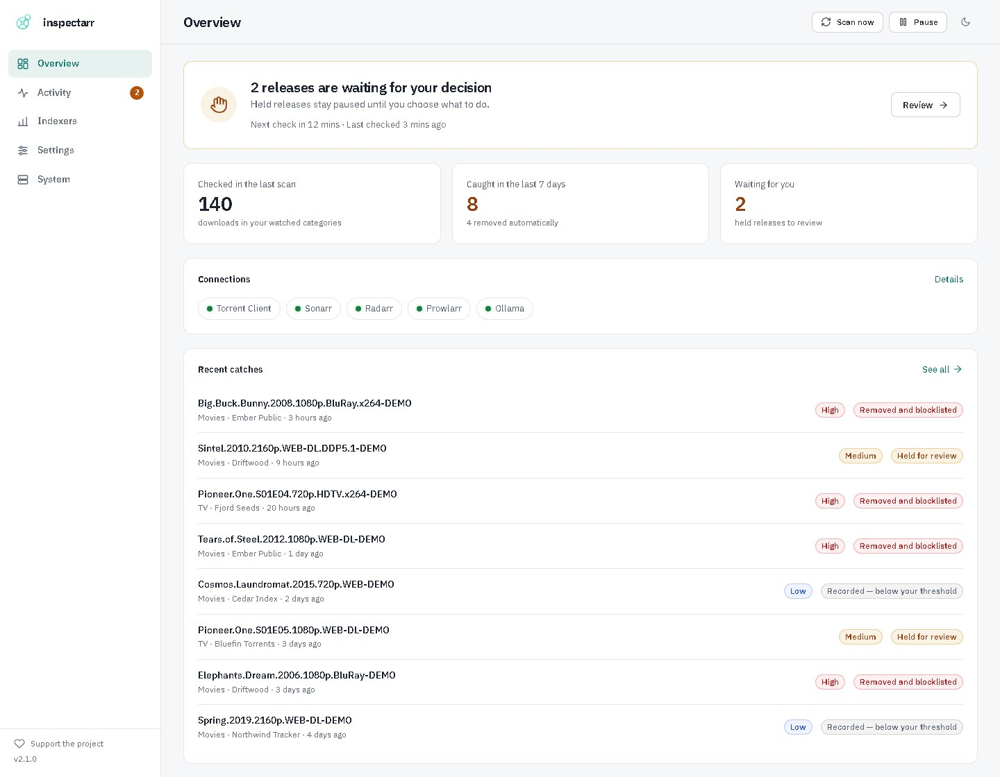
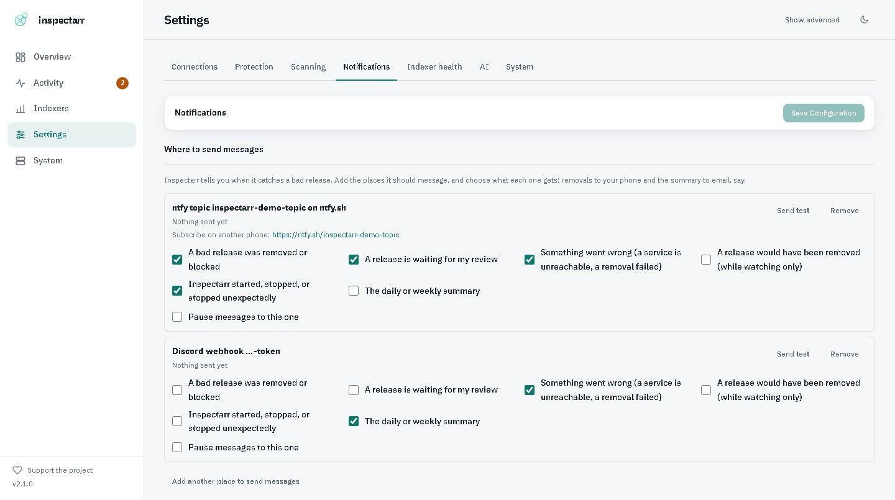
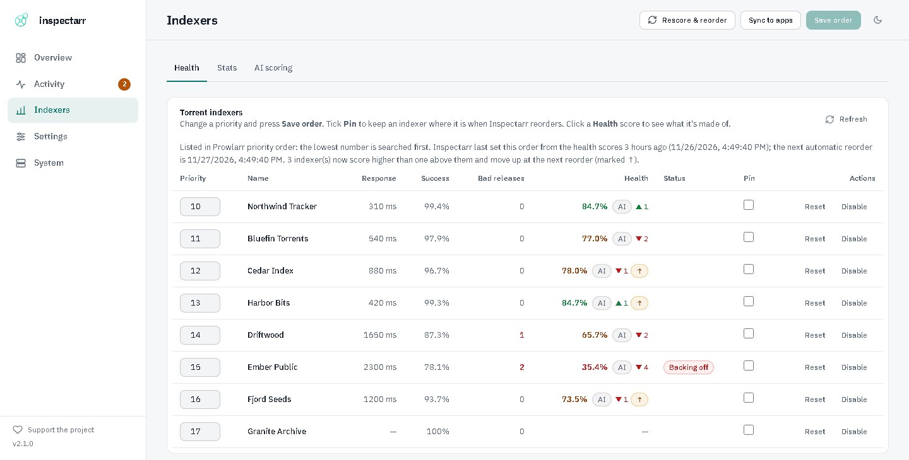
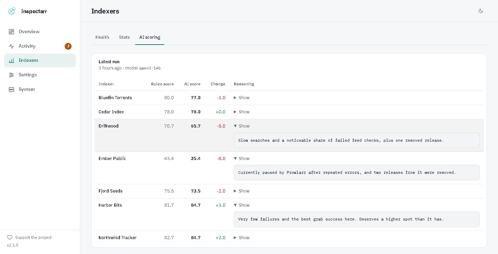
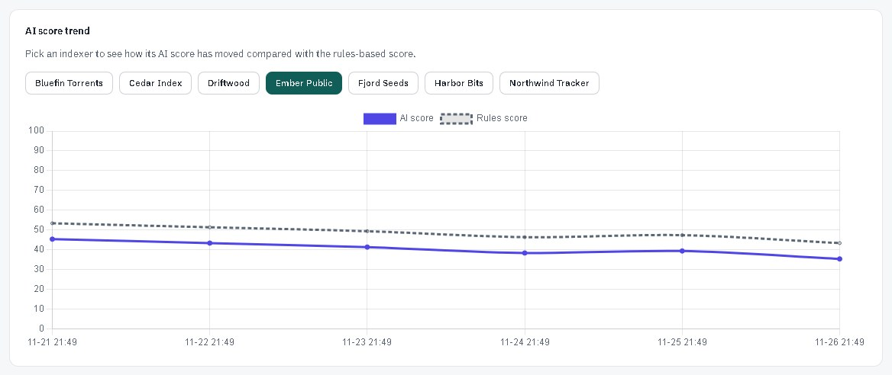

<p align="center">
  
</p>

<p align="center">
  <b>A watchdog for your *arr downloads</b><br>
  Catches bad releases before they reach your library, and keeps your indexers honest.
</p>

<p align="center">
  <a href="https://github.com/o51r15/inspectarr/releases/latest"></a>
  <a href="https://github.com/o51r15/inspectarr/pkgs/container/inspectarr"></a>
  <a href="https://github.com/o51r15/inspectarr/actions"></a>
  <a href="https://github.com/o51r15/inspectarr/blob/main/LICENSE"></a>
</p>

---

Sonarr, Radarr and Lidarr only notice a bad release when its import fails, and each one only
knows about itself. Nothing stops an `.exe` sitting in a TV download, and nothing tells you which
indexer keeps sending them.

**Inspectarr** watches your download client directly. When a download contains something your
rules flag, it removes it, blocks that release in the right \*arr app so a clean copy is found
instead, and tells you. It also keeps track of which indexer each bad release came from, scores
every indexer's health, and puts the reliable ones first in Prowlarr.

One container, no cloud services, and nothing is removed until you say so.

<p align="center">
  
  <br><em>The Overview page shows what needs your attention, what was caught this week and whether every service is connected.</em>
</p>

---

## How it works

1. **Check.** On a schedule, and instantly when Sonarr or Radarr grabs something, Inspectarr
   looks at the files in each download in the categories you watch.
2. **Grade.** Each finding gets a severity: programs and scripts are *critical*, archives and a
   main file that is too small are *high*, suspicious file names are *medium*. A release is
   graded by its worst finding.
3. **Act.** Depending on the grade and your settings, the release is recorded, paused and held
   for your review, or removed and blocked in Sonarr, Radarr or Lidarr so a replacement is found.
4. **Learn.** Every catch is credited to the indexer that served it. Inspectarr scores each
   indexer's health and reorders them in Prowlarr so the best are searched first.

New to it? Start in **Watch only** mode: Inspectarr records what it would have done without
touching anything, so you can check your rules before letting it act.

---

## Features

**Protection**
- Rules per download category: file types to catch, file names to catch (regular expressions)
  and a minimum size for the main file
- Three modes: **Watch only**, **Hold for my review** and **Remove automatically**. A banner on
  every page shows when Inspectarr is being held back
- Severity grading decides what each catch leads to: record it, hold it, or remove it
- A review queue for held releases, with **Release**, **Keep paused** and **Delete**, and an
  optional time limit
- Removal blocks the release in Sonarr, Radarr or Lidarr, and retries if one of them is unreachable
- A full record of every catch: which files, which check, how it was graded and what was done
- Replacement tracking: after a removal, whether the \*arr found a good copy and from which indexer

**Indexer health** *(needs Prowlarr)*
- A 0–100 score per indexer from speed, failed searches, download success and safety. Click a score
  to see how it was worked out
- Up and down arrows show how each score changed since the last one
- Automatic reordering in Prowlarr, with pins for indexers you want to stay where they are
- Optional automatic switch-off for an indexer that stays unhealthy, and back on after a cooldown

**AI scoring** *(optional, needs Ollama, off by default)*
- A local model reviews each indexer's numbers and may adjust its score, with a one-line reason
- The AI can only move a score within a limit you set (30 points by default) and can never switch
  an indexer off on its own
- **Calibrate** tests each model on your server against 14 indexers with known answers, finds the
  best settings for it, and ranks your models by accuracy and speed
- Use the built-in scoring instructions or write your own and test them side by side

**Notifications**
- Send to ntfy, Pushover, Telegram, Discord, Gotify, email, or any
  [Apprise](https://github.com/caronc/apprise/wiki) service, each with its own choice of events
- ntfy set-up in one step: Inspectarr makes a private topic and shows a QR code to scan
- **Send test** on each one, and a plain-English reason when a message can't be delivered
- Alerts when Inspectarr stops, or restarts after a crash, and an optional daily or weekly summary

**Running it**
- Works with qBittorrent, Transmission and Deluge
- Scheduled checks, instant checks from Sonarr and Radarr webhooks, or both
- Web interface for desktop and phone, in light and dark themes
- Docker image that runs as a non-root user and keeps everything in one data folder
- `/api/health` for container health checks, a small JSON API, and a CLI with a daemon mode

---

## Quick start

### Docker Compose (recommended)

```yaml
services:
  inspectarr:
    image: ghcr.io/o51r15/inspectarr:latest
    container_name: inspectarr
    user: "${PUID:-1000}:${PGID:-1000}"
    restart: unless-stopped
    ports:
      - "8585:8585"
    volumes:
      - ./data:/app/data
      - ./config.yaml:/app/config.yaml
```

```bash
cp config.example.yaml config.yaml   # add your URLs and API keys
docker compose up -d
```

> **Tip:** set `user` to your own user and group IDs (`id -u` and `id -g`) so Inspectarr can
> write to the mounted folder. It defaults to `1000:1000`.

### Docker run

```bash
docker run -d --name inspectarr \
  --user "$(id -u):$(id -g)" \
  -p 8585:8585 \
  -v ./data:/app/data \
  -v ./config.yaml:/app/config.yaml \
  ghcr.io/o51r15/inspectarr:latest
```

### From source

```bash
git clone https://github.com/o51r15/inspectarr.git && cd inspectarr
pip install -r requirements.txt
cp config.example.yaml config.yaml
python3 web.py
```

### First steps

1. Open `http://your-server:8585`.
2. In **Settings → Connections**, connect your download client and at least one of Sonarr,
   Radarr or Lidarr. Press **Test** on each.
3. In **Settings → Protection**, choose **Watch only** and add a rule for each download category
   you want checked.
4. Press **Resume** on the Overview page to start checking. Inspectarr starts paused on a fresh
   install so nothing happens before you are ready.
5. Once the catches on the **Activity** page look right, switch to **Hold for my review** or
   **Remove automatically**.

---

## Using Inspectarr

The web interface has five sections, all reachable from the sidebar.

| Section | What you'll find |
|---|---|
| **Overview** | What needs your attention, catches in the last seven days, service connections, recent catches. **Scan now** and **Pause / Resume** are here |
| **Activity** | **Needs review** (held releases waiting for you), **History** (every catch, with the reasons), **Torrents** (what's in your download client) |
| **Indexers** | **Health** (scores, order and changes), **Stats** (grabs and bad releases per indexer), **AI scoring** (the model's verdicts and reasoning) |
| **Settings** | Connections, Protection, Scanning, Notifications, Indexer health, AI, System |
| **System** | Status, Events (the log), Notifications (what was sent), Tasks (schedule and recent scans), Updates |

Changes in Settings are saved to `config.yaml` and apply from the next check, with no restart
needed (except the web port). You can also edit the file itself under
**Settings → System → Edit the config file**.

### Notifications

Add each place you want to hear from and tick what it should get: removals, releases waiting for
review, problems, start-up and shutdown, or the summary. Every place has its own **Send test**
button and shows whether its last message got through.

<p align="center">
  
  <br><em>Settings → Notifications: each place gets only the messages you choose.</em>
</p>

---

## Indexer health scoring

If you use Prowlarr, Inspectarr gives every torrent indexer a health score from 0 to 100 and
puts the healthiest first, so Sonarr and Radarr search them before the rest.

<p align="center">
  
  <br><em>Indexers → Health. Arrows show each score's change since the last one; ↑ marks an indexer that will move up at the next reorder.</em>
</p>

The score is built from four parts and two adjustments. Click any score on the page to see them
for that indexer.

| Part | What it measures | Default share |
|---|---|---|
| **Speed** | How quickly the indexer answers searches. Fast answers score well; slow ones lose points steeply | 25% |
| **Searches** | How rarely it fails (called *Reliability* in Settings). Login failures count 3×, download failures 2×, searches 1×, RSS checks 0.5× | 30% |
| **Downloads** | How often a grab from it succeeds | 25% |
| **Safety** | How rarely its releases turn out to be bad | 20% |
| *Paused* | 20 points off while Prowlarr has paused the indexer for repeated errors | — |
| *Trend* | Up to 10 points either way, from the direction of its last five scores | — |

Indexers are reordered on a schedule you choose (once a day by default) or straight away with
**Rescore & reorder**. Pin an indexer to keep it where it is. You can also have Inspectarr switch
off an indexer that stays below a health threshold, and try it again after a cooldown.

Every share, multiplier and threshold can be changed under **Settings → Indexer health**. See the
[wiki](https://github.com/o51r15/inspectarr/wiki/Prowlarr-Indexer-Scoring) for the details.

### AI scoring (optional)

With [Ollama](https://ollama.com) connected and AI turned on, a local model reviews each
indexer's numbers and may adjust Inspectarr's score, giving a one-line reason. The **AI scoring**
tab shows the rules score, the AI's score and the reasoning side by side, so a change is never
hidden.

<p align="center">
  
  <br><em>Indexers → AI scoring: what the model changed, and why.</em>
</p>

Safeguards keep the AI in check:

- It can only move a score within a limit you set: 30 points either way by default.
- It can never switch an indexer off on its own. That needs Inspectarr's own score to be low too.
- If the model fails or gives an unusable answer, Inspectarr's own score is used.
- Answers are cached, so an unchanged indexer isn't sent to the model again.

Pick a model under **Settings → AI** and press **Calibrate** first. It tests the model against 14
indexers with known answers, finds the best settings for your server, and ranks it against your
other models.

<p align="center">
  
  <br><em>The trend chart compares one indexer's AI score with its rules score over time.</em>
</p>

---

## Command line

```bash
python3 inspectarr.py                    # one scan, then exit
python3 inspectarr.py --test             # test every configured connection, then exit
python3 inspectarr.py --dry-run          # scan and record, but take no action
python3 inspectarr.py --retry-now        # retry failed removals now, then scan
python3 inspectarr.py --daemon           # keep scanning until stopped
python3 inspectarr.py --config /path     # use a different config file
```

---

## Requirements

- **A download client:** qBittorrent 4 or 5 (Web UI on), Transmission (RPC on) or Deluge (Web UI on)
- **At least one of:** Sonarr v4, Radarr v3, Lidarr v2
- **Prowlarr** *(optional)*: for indexer scoring and knowing which indexer served each release
- **Ollama** *(optional)*: for AI scoring
- **Python 3.12 or later**, only if you run from source

---

## Configuration

Everything lives in `config.yaml`. Copy `config.example.yaml` to start; most options can then be
changed in **Settings**. The [Configuration](https://github.com/o51r15/inspectarr/wiki/Configuration)
wiki page lists every option.

## Your data

Mount `data/` as a volume. It holds everything Inspectarr remembers:

| File | Contents |
|---|---|
| `inspectarr.db` | The database: catches, held releases, retries, scan history, indexer scores |
| `inspectarr.log.json` | The event log, one JSON event per line |
| `backups/` | Backups made under **Settings → System**, each a zip of your config and database |

## Docker images

| Tag | Built from |
|---|---|
| `ghcr.io/o51r15/inspectarr:latest` | Each release |
| `ghcr.io/o51r15/inspectarr:dev` | Every change to `main`. Newest features, less tested |

A [dev container](https://containers.dev/) configuration is included for VS Code and Codespaces.

---

## Help and links

- [Wiki](https://github.com/o51r15/inspectarr/wiki): installation, configuration, rules, scoring and troubleshooting
- [Discussions](https://github.com/o51r15/inspectarr/discussions): questions and ideas
- [Issues](https://github.com/o51r15/inspectarr/issues): bug reports and feature requests
- [Releases](https://github.com/o51r15/inspectarr/releases): what changed in each version
- [Security policy](SECURITY.md): how to report a vulnerability privately

## License

[MIT](LICENSE)
